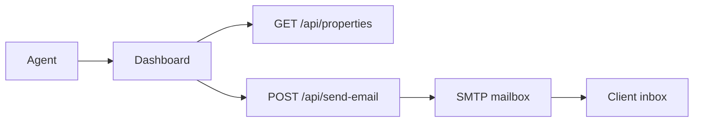

# Home Send

A single-page app for one demo Spanish agency. Agents sign in with a fake login, search and filter a seeded property list, select homes, and send one branded email to a client. Azure Static Web Apps hosts the UI. A linked Azure Function sends the mail. A GitHub Action deploys both on push to `main`.

Build Home Send as a React app on Azure Static Web Apps: a fixed fake login as George Nayda, a searchable property dashboard for Bromley Estates Marbella, and an SMTP-backed Azure Function that sends the selected homes so the message appears from George Nayda at Bromley.

## Work

- Scaffold the Vite React frontend and Azure Functions v4 API, with a local `/api` proxy
- Add Bromley Estates branding, George Nayda as the only demo agent, and load every JSON file in properties as the catalog
- Build the login, property browser, send composer, and sent list to the visual system, with intro, footer, and sent mail saved in the browser against the demo user
- Render the branded HTML email in the same visual system and send it from `POST /api/send-email` over SMTP so it appears from George Nayda at Bromley, with dry-run
- Add the Static Web App config, GitHub Action, and README setup steps for the deployment token and SMTP settings

## Stack

- Frontend: React, TypeScript, Vite in [`frontend/`](frontend/)
- API: Azure Functions v4 (Node 20) in [`api/`](api/)
- Mail: SMTP from the Azure Function, using the host, port, username, and password supplied later. The visible From name is `George Nayda`. The address beside that name is the mailbox those credentials belong to. The email header, intro, and footer say Bromley Estates, so the message reads as George Nayda at Bromley. A Bromley address only appears if the mailbox provided is on that domain.
- Brand and catalog live in the API. The UI reads them from `GET /api/properties`, so the email is built from the same records the agent saw.

The send function is the only place that knows the mail server. If the access provided is an API key instead of SMTP, only that function changes.

## Demo agency and agent

One config object drives the dashboard header and the email. The demo company is **Bromley Estates Marbella** ([bromleyestatesmarbella.com](https://bromleyestatesmarbella.com/)).

- Logo: the supplied teal square mark with the white B, copied from [`agent-logo-22159-1779531666.png`](agent-logo-22159-1779531666.png) into the frontend public assets. Accent color is sampled from that mark.
- Tagline: Marbella’s Premier Real Estate Agency
- Offices: Urbanización el Rosario, N-340, km188, 29604 Marbella, Málaga
- Phones: +34 952 939 460 and +44 208 068 7606
- Agency email: info@bromleyestatesmarbella.com
- Website: https://bromleyestatesmarbella.com/

The demo agent is **George Nayda**. His portrait is copied from [`1790616118479.png`](1790616118479.png) and shown in the dashboard header and the email footer. Public contact used for him: hello@georgenayda.com and +34 951 870 121. Reply-To is the mailbox that sends the mail, so the client replies to the account that was provided.

Fake login, client-side only, and locked to George. His name and email are shown and cannot be edited. Any non-empty password signs in. There is one saved intro, one footer, and one sent list. Session stays in `sessionStorage`. The login page shows that hint. No accounts and no database.

## Property model

The catalog is the JSON files in [`properties/`](properties/). Six are there now (`bemp2010`, `bemv2009`, `bemd3172`, `bemd3173`, `bemd2993`, `bemd2995`). About 170 will be added as more files in that folder. The API reads every `*.json` file in the folder at startup. A new home is a new file. No code change and no temporary stand-in listings.

Each file already has the fields the screens use: `id`, `reference`, `title`, `summary`, `description`, `transaction`, `type`, `price`, `bedrooms`, `bathrooms`, `builtAreaM2`, `plotAreaM2`, `terraceAreaM2`, `municipality`, `province`, `area`, `address`, `features`, `imageUrl`, `images`, and `sourceUrl`. The current types are Apartment, Townhouse, Villa, and Plot. Prices are EUR. Missing numbers stay blank on the card rather than showing as zero.

Search matches title, reference, address, and municipality. Filters: transaction, property type, municipality, minimum bedrooms, price min/max. Filtering stays in the browser. One hundred and seventy records is small enough for that, so the list still updates as the agent types.

Cards and the email use `imageUrl` only, lazy-loaded. `images` and the long `description` stay out of the email so a message with several homes does not become huge. Each home in the email links to `sourceUrl`. The sent-list snapshot stores id, reference, title, price, town, `imageUrl`, and `sourceUrl`.

Each card has a separate button labelled with the property `reference` (for example `BEMP2010`). It opens that listing on [Resales Online](https://www.resales-online.com/) in a new tab. The address is `https://www.resales-online.com/` with the `reference` as the property id, so `BEMP2010` goes to that home and not to the site root. Pressing the button does not select or deselect the card. The client email still uses `sourceUrl` on the Bromley site.

## Send flow

The agent checks properties, then opens **Send email to client** and enters client name, client email, the intro, and the footer.

The intro and footer are plain text the agent can rewrite. Defaults come from the branding config: a short introduction from George, and a footer with his phone, email, and the Bromley office lines. Edits are saved in `localStorage` under the logged-in demo user’s email, so signing in again as George on this browser restores his intro and footer. Nothing is stored on the server. A different browser or computer starts from the defaults. A reset control restores the defaults for that user. Clearing the site data does the same.

`POST /api/send-email` body: client name, client email, agent name, agent email, intro, footer, property ids.

The function validates the payload (email shape, 1–8 ids, ids must exist, intro and footer length caps), escapes the text, renders HTML, and sends through SMTP. It does not write the copy anywhere. `DRY_RUN=true` returns the HTML and does not contact the mail server, so the UI can be checked before the mailbox credentials exist. Production leaves dry-run off.

After a successful response, the browser appends that email to a sent list in `localStorage`, keyed by the logged-in demo user’s email, beside the saved intro and footer. The login itself stays in `sessionStorage` and ends when the tab closes. The sent list stays on this computer, so the next time George signs in here he still sees what went out. Another computer has an empty list. The server never stores it.

Each entry keeps the time, client name, client email, intro, footer, and a snapshot of the homes (id, reference, title, price, town, image, and source link). The preview is rendered again from that snapshot, so the stored record stays small. The list keeps the newest 50. A dry-run success is stored too and labelled as not delivered.

The endpoint is anonymous behind the Static Web App. The function still rejects bad payloads and caps the list at 8. It is not a private API until real auth exists.

## Email

Table layout, inline CSS, about 640px wide, so it holds up in major clients.

- Header: Bromley B mark, agency name, teal bar, Marbella. This stays fixed.
- Greeting using the client’s name, then the agent’s intro, with line breaks kept
- One block per property: photo, title, reference, price, town, beds / baths / m², summary
- Footer: George’s portrait, then the agent’s footer text. The portrait stays fixed so the email still reads as his.

The email uses the same type, teal, and spacing as the app, so the message the client opens feels like the screen the agent just approved.

## Azure and GitHub

[`staticwebapp.config.json`](frontend/public/staticwebapp.config.json) SPA fallback so refresh on the dashboard works.

[`.github/workflows/azure-static-web-apps-white-moss-0cdfec610.yml`](.github/workflows/azure-static-web-apps-white-moss-0cdfec610.yml) uses `Azure/static-web-apps-deploy@v1`:

- `app_location`: `frontend`
- `api_location`: `api`
- `output_location`: `dist`
- Deploy on push to `main`; preview environments on pull requests

GitHub secret: `AZURE_STATIC_WEB_APPS_API_TOKEN_WHITE_MOSS_0CDFEC610` (from the Static Web App resource).

`api/mail.settings.json` commits `SMTP_HOST`, `SMTP_PORT`, `MAIL_FROM_NAME` (`George Nayda`), and `DRY_RUN` (`false`). `SMTP_USER`, `SMTP_PASSWORD`, and `MAIL_FROM` are GitHub secrets. The deploy workflow writes them for the API. They are not committed.

A short [`README.md`](README.md) covers the Static Web App workflow Azure generated, the deployment secret, and where to put the mailbox access. Local run is Vite plus `func start`, with the Vite dev server proxying `/api`.

Before a live email can leave the app, two things are required: the Static Web App deployment token, and the SMTP (or equivalent) access for the mailbox. The app can be built and checked with dry-run before either exists. The visible sender is George Nayda, with Bromley Estates in the message.

## UI

The interface is the product. It should feel like a tool shipped by a top product team: quiet, fast, and obvious. The reference is a luxury property shortlist, not an admin table. English UI. Custom CSS with a small set of tokens. No component-library skin.

Visual system:

- Ink on warm paper. Background is a warm off-white, text is near-black, cards are white. The Bromley teal is the accent only: the mark, the selected state, and the primary button. It is not a page wash.
- Headlines in a serif with real character (Newsreader or Fraunces). Labels, prices, and controls in a neutral sans (Inter), with tight labels and tabular numbers for prices.
- Space is generous. One type scale, one radius, one shadow. Cards lift slightly; they do not float on heavy drop shadows.
- Motion is short, about 180–220ms, ease-out. Selection, the bottom bar, and the composer move. Nothing bounces. `prefers-reduced-motion` disables it.
- Property photos are real photography at a consistent 4:3 crop. Skeleton blocks stand in while the list loads. Focus rings are visible. Hit targets stay at least 44px. The layout is checked at a phone width and a desktop width.

Home. The public page at `/` sells Home Send and carries no agency name, agent name, portrait, phone, office, or website. Its mark is the card icon, and the page is mint on a pale green ground, separate from the agency teal. Sign-in and the working screens use the agency mark and the warm paper and teal. The hero promises one email of the right homes, then offers “Send a shortlist” (or “Open the list” when already signed in) and a jump to a sample email. That sample uses the house icon and a charcoal header. Under the hero, the page says what the client receives and the three moves that send a list. A closing band on `hero-detail.png` repeats the action. Sign-in stays at `/sign-in`.

Login. A split screen. One side is a full-bleed Costa del Sol photograph with the B mark and one line of positioning. The other side is only the form: George’s name and email already filled, password, and one button, “Continue”. On a phone the photograph becomes a short band above the form. Errors sit under the field that failed.

Property browser. A thin top bar holds the B mark, “Home Send”, two links (Select and Sent), George’s portrait and name, and Sign out. The page title is “Select homes”, with a single line under it. Search is a large field that filters as the agent types. Filters are a row of compact controls: transaction, type, town, bedrooms, and price. Active filters read as removable chips, and the result count sits beside them. “Clear” appears only when a filter is on.

Each home is a card: photograph, price, title, town, then beds, baths, and size as quiet metadata. The whole card is the hit target. Selected cards get a teal edge and a check, and the photograph does not shrink. There is no spreadsheet checkbox column. A text button on the card shows the reference and opens that property on Resales Online. It sits apart from the card hit target, so choosing it does not change the selection.

When one or more homes are selected, a bar rises from the bottom: “3 homes selected” and a primary “Send to client”. It stays put while the list scrolls. Zero results is a designed empty state with the search terms and a way to clear filters. It is not a blank page.

Composer. “Send to client” opens a large sheet. On desktop, the form is on the left and a live email preview is on the right, updating as the intro, footer, or client name changes. On a phone, Form and Preview are two segments of the same sheet. Fields are client name, client email, intro, and footer, with the saved copy for George already in place and a text button to reset both to the defaults. The primary action is “Send email”. While it sends, the button shows progress and cannot be pressed again. Success replaces the form with a calm confirmation that names the client and the number of homes, then offers “View sent” and “Done”. Failure keeps the draft and explains what went wrong in one sentence. A failed send is not added to the list.

Sent. A quiet list, newest first. Each row shows the date and time, the client’s name and email, how many homes, and the town or title of the first home. A dry-run row says it was not delivered. Opening a row shows the same email preview, read only, with the homes that were included. An empty list says nothing has been sent yet and offers a way back to Select.
